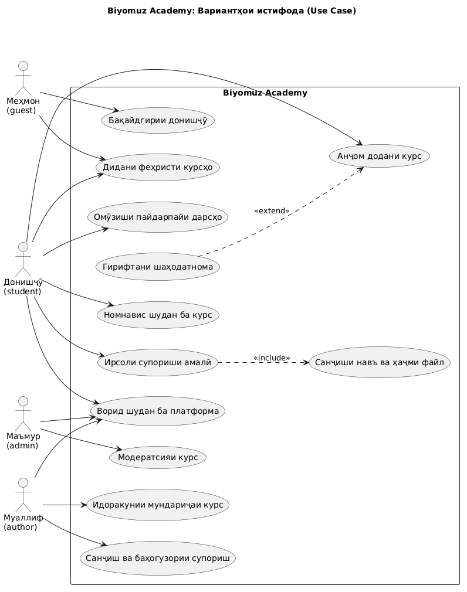
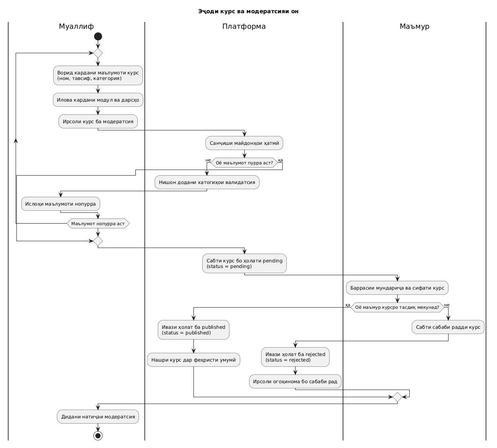
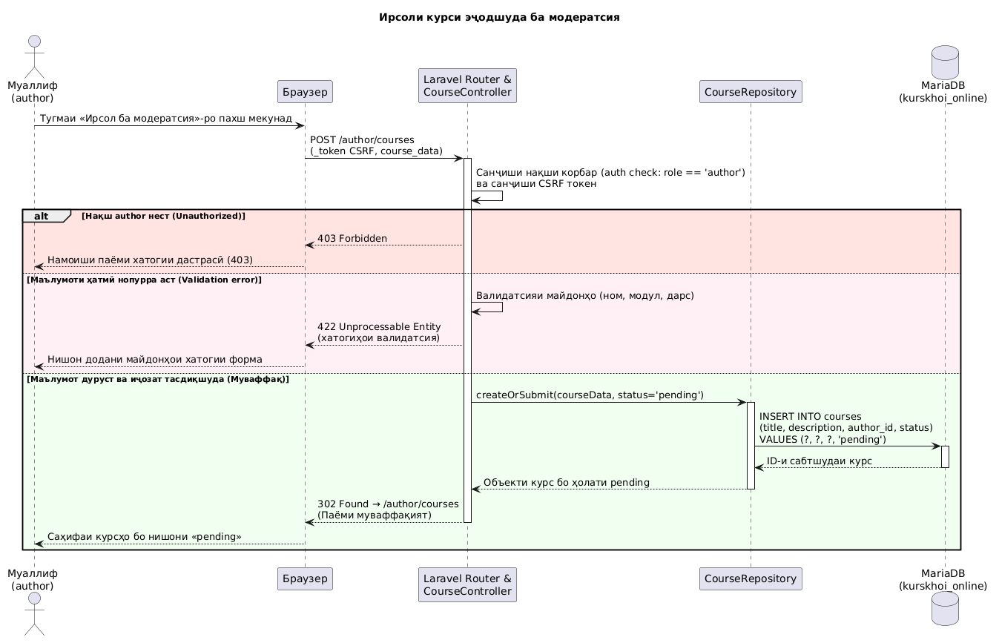
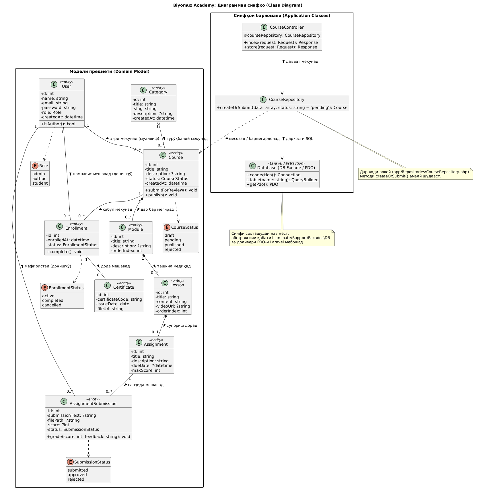
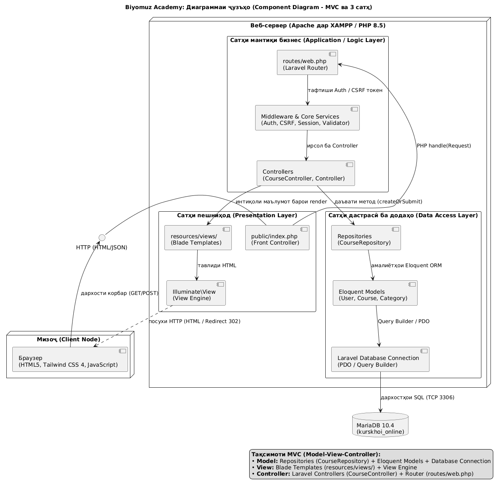
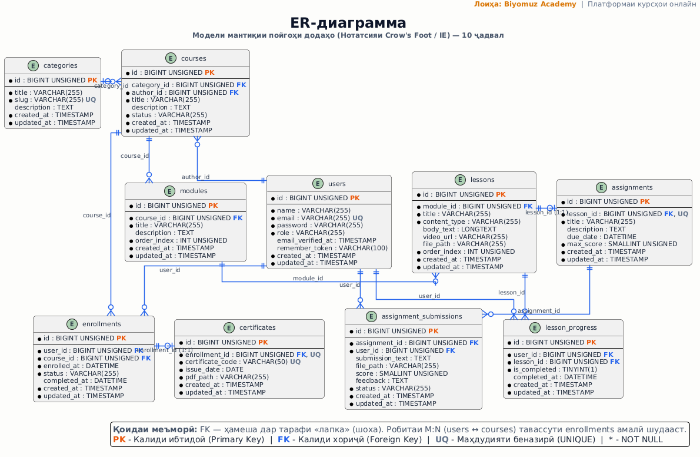
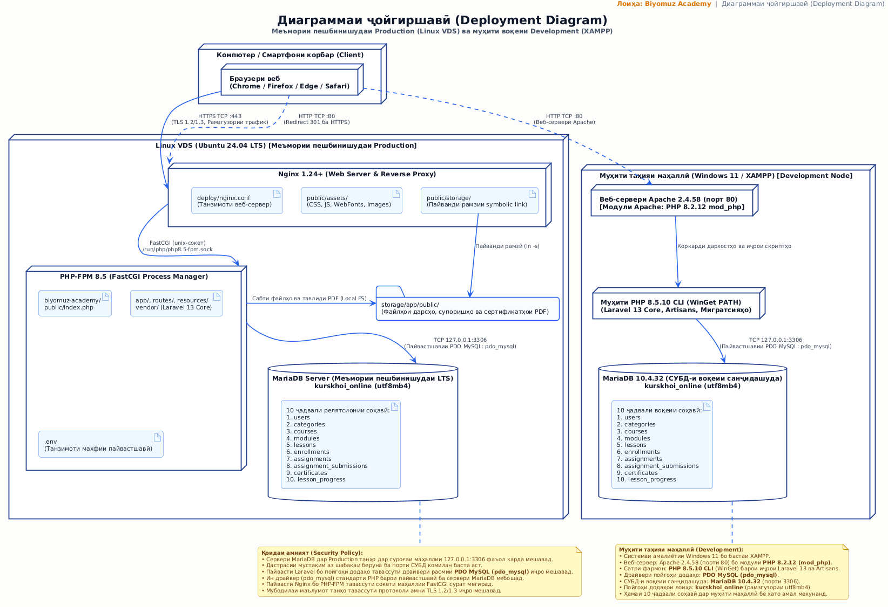

# Супориши техникӣ барои коркарди платформаи курсҳои онлайн «Biyomuz Academy»

**Версияи ҳуҷҷат:** 1.0  
**Санаи пешниҳод:** 15 ноябри соли 2026  
**Муаллиф ва барномасоз:** Ғаффоров Зуҳриддин Ҳусниддинович  
**Гурӯҳи таълимӣ:** 4_40.01.01та  
**Фан:** Технологияҳо ва забонҳои Internet барномасозӣ  
**Роҳбари илмӣ (омӯзгор):** Сафаров Ғаниҷон  
**Фармоишгар:** Маркази таълимии «Biyomuz Academy» (шартан, дар доираи лоиҳаи таълимии курсӣ)  
**Ҳолати ҳуҷҷат:** Лоиҳаи супориши техникӣ (Пешниҳоди корҳои иҷрошуда барои санҷиш ва ҳимоя дар марҳилаи якуми рейтингӣ (Р-1).)

---

## Мундариҷа
1. [Маълумоти умумӣ](#1-маълумоти-умумӣ)
2. [Таъинот ва мақсадҳои эҷоди система](#2-таъинот-ва-мақсадҳои-эҷоди-система)
3. [Тавсифи объекти автоматикунонӣ](#3-тавсифи-объекти-автоматикунонӣ)
4. [Талабот ба система](#4-талабот-ба-система)
   - [4.1. Талабот ба система дар маҷмӯъ](#41-талабот-ба-система-дар-маҷмӯъ)
   - [4.2. Талабот ба функсияҳо, таърихчаҳои корбар ва матритсаи дастрасӣ](#42-талабот-ба-функсияҳо-таърихчаҳои-корбар-ва-матритсаи-дастрасӣ)
   - [4.3. Талабот ба намудҳои таъминот](#43-талабот-ба-намудҳои-таъминот)
5. [Моделҳои система](#5-моделҳои-система)
   - [5.1. Диаграммаи вариантҳои истифода (Use Case Diagram)](#51-диаграммаи-вариантҳои-истифода-use-case-diagram)
   - [5.2. Диаграммаи фаъолият (Activity Diagram)](#52-диаграммаи-фаъолият-activity-diagram)
   - [5.3. Диаграммаи пайдарпайӣ (Sequence Diagram)](#53-диаграммаи-пайдарпайӣ-sequence-diagram)
   - [5.4. Диаграммаи синфҳо (Class Diagram)](#54-диаграммаи-синфҳо-class-diagram)
   - [5.5. Диаграммаи ҷузъҳо (Component Diagram)](#55-диаграммаи-ҷузъҳо-component-diagram)
   - [5.6. ER-диаграммаи пойгоҳи додаҳо (ER Diagram)](#56-er-диаграммаи-пойгоҳи-додаҳо-er-diagram)
   - [5.7. Диаграммаи ҷойгиркунӣ (Deployment Diagram)](#57-диаграммаи-ҷойгиркунӣ-deployment-diagram)
6. [Таркиб ва мундариҷаи корҳо](#6-таркиб-ва-мундариҷаи-корҳо)
7. [Тартиби назорат ва қабул](#7-тартиби-назорат-ва-қабул)
   - [7.1. Тартиби санҷиш ва озмоишҳо](#71-тартиби-санҷиш-ва-озмоишҳо)
   - [7.2. Меъёрҳои расмии қабули низом](#72-меъёрҳои-расмии-қабули-низом)
   - [7.3. Санҷиши воқеии пойгоҳи додаҳо](#73-санҷиши-воқеии-пойгоҳи-додаҳо)
   - [7.4. Пайгирии талабот то ҷадвалҳои пойгоҳи додаҳо](#74-пайгирии-талабот-то-ҷадвалҳои-пойгоҳи-додаҳо)
8. [Талабот ба ҳуҷҷатгузорӣ](#8-талабот-ба-ҳуҷҷатгузорӣ)
9. [Манбаъҳои коркард](#9-манбаъҳои-коркард)

---

## 1. Маълумоти умумӣ

### 1.1. Номи пурра ва шартии система
- **Номи пурраи лоиҳа:** Веб-платформаи курсҳои онлайни «Biyomuz Academy».
- **Номи кӯтоҳ ва нишони бренд:** Biyomuz.
- **Шиори асосӣ:** «Имрӯз биёмӯз, фардо муваффақ шав!»

### 1.2. Мавзӯи лоиҳа ва асоси коркард
Лоиҳа дар доираи барномаи таълимии фанни «Технологияҳо ва забонҳои Internet барномасозӣ» аз рӯи мавзӯи тасдиқшудаи «Коркарди веблоиҳаи платформаи курсҳои онлайн» амалӣ мегардад. Ҳуҷҷати мазкур ҳамчун **супориши техникӣ бо истифода аз сохтори ихтисоршудаи таълимӣ дар асоси ГОСТ 34.602-2020** таҳия гардида, ҷамъбасти артефактҳои корҳои лаборатории №1–7-ро барои ҳимояи рейтинги якум (Р-1) фаро мегирад.

### 1.3. Тарафҳои лоиҳа
- **Фармоишгар:** Маркази таълимии «Biyomuz Academy» (шаҳри Хуҷанд). Дар марҳилаи таълимӣ фармоишгар хусусияти шартӣ дошта, нақши қабулкунандаи кори лоиҳавиро омӯзгори фан Сафаров Ғаниҷон мебошад.
- **Иҷрокунанда (Барномасоз):** Донишҷӯи гурӯҳи 4_40.01.01та — Ғаффоров Зуҳриддин Ҳусниддинович.

### 1.4. Мӯҳлати иҷро ва тақсимоти марҳилавӣ
Лоиҳа дар давоми як семестри таълимӣ (тирамоҳ-зимистони соли таҳсили 2026–2027) иҷро мешавад. Нақшаи тақвимии корҳо 6 марҳиларо дар бар гирифта, давраи рӯзҳои 8–16-уми давраи таълимиро (аз Р-1 то Р-2) фаро мегирад.

---

## 2. Таъинот ва мақсадҳои эҷоди система

### 2.1. Таъиноти система
Системаи иттилоотии «Biyomuz Academy» барои таъсиси муҳити мутамаркази таълими фосилавӣ, автоматикунонии раванди пешниҳоди дарсҳо, сабти номи донишҷӯён, идоракунии сохтори таълимӣ, пайгирии пешрафти инфиродии таълим, санҷиши супоришҳои амалӣ аз ҷониби муаллифон ва тавлиди шаҳодатномаҳои электронии хатм таъин шудааст.

### 2.2. Мақсадҳои ченшавандаи лоиҳа
Дар асоси бахши 1-и супориши кӯтоҳи техникӣ (`docs/03-short-spec.md`), система ба дастёбӣ ба ҳадафҳои зерини ченшаванда равона карда шудааст:
1. **Коҳиши вақти номнависӣ ба курсҳо:** Автоматикунонии раванди сабти ном ва номнависӣ ба курсҳо, ки дар натиҷа вақти дастрасӣ ба маводи таълимӣ аз 1–2 рӯзи интизории дастии маъмурият то ба **фаврӣ (камтар аз 2 сония)** коҳиш меёбад (пайваст ба FR-02, FR-04).
2. **Мутамарказкунонии маводи таълимӣ:** Фароҳам овардани сохтори ягонаи сезинагии «Курс → Модул → Дарс», ки парокандагии маводро дар паёмрасонҳо ва хадамоти абрӣ 100% бартараф мекунад (пайваст ба FR-07).
3. **Санҷиши супоришҳо дар давоми то 1 рӯзи корӣ:** Таъмини механизми дохилии ирсоли файл ва баҳогузорӣ бо ҳадафи таъмини санҷиши супоришҳо дар давоми то 1 рӯзи корӣ ба ҷои 2–5 рӯзи мукотиба дар паёмрасонҳо (пайваст ба FR-06, FR-08).
4. **Сабти 100%-и пешрафти таълимӣ:** Автоматикунонии назорати пайдарпайии дарсҳо, ки имкон намедиҳад донишҷӯ бе азхуд кардани мавзӯи қаблӣ ба дарсҳои оянда гузарад (пайваст ба FR-05).
5. **Тавлиди шаҳодатномаи рақамӣ:** Эҷоди автоматии санади тасдиқкунандаи хатми курс дар формати PDF бо рамзи беназири санҷишӣ (Verification Code) дар зарфи **камтар аз 3 сония** пас аз анҷоми бомуваффақияти тамоми дарсҳо ва супоришҳо (пайваст ба FR-10).

---

## 3. Тавсифи объекти автоматикунонӣ

### 3.1. Тавсифи соҳаи предметӣ
Маркази таълимии «Biyomuz Academy» (шаҳри Хуҷанд) ба таълими касбии технологияҳои иттилоотӣ (барномасозии веб, пойгоҳи додаҳо, тарроҳии рақамӣ) машғул аст. Қаблан раванди таълим бо истифода аз абзорҳои гуногуни ҷудогона (паёмрасонҳо, хадамоти абрии нигоҳдории файлҳо, ҷадвалҳои электронии дастӣ) амалӣ мегашт, ки ба парокандагии маводҳо, набудани махзани ягона ва мушкилоти ҷиддӣ дар пайгирии пешрафти таълимии донишҷӯён оварда мерасонд.

### 3.2. Мушкилоти ҷараёни мавҷуда
- **Парокандагии маводи таълимӣ:** набудани платформаи ягона барои дастрасии мураттаб ба дарсҳои матнӣ ва видеоӣ.
- **Мушкилии пайгирии пешрафт:** муаллифон ва маъмурият фоизи дақиқи азхудкунии дарсҳоро дида наметавонистанд, чунки сабти худкор мавҷуд набуд.
- **Санҷиши дастии супоришҳо ва таъхири тақризҳо:** супоришҳо тавассути паёмрасонҳо фиристода шуда, файли корҳо гум мешуданд ва донишҷӯён сари вақт фикру мулоҳиза намегирифтанд.
- **Набудани низоми мутамаркази идоракунӣ:** равандҳои бақайдгирӣ, эҷоди курсҳо ва модератсия пароканда анҷом меёфтанд.

### 3.3. Иштирокчиён ва модели чоргонаи нақшҳо
Дар платформа модели чоргонаи нақшҳо (`guest`, `student`, `author`, `admin`) амал мекунад:
1. **`guest` (Меҳмон):** Корбари беном ва сабтиномнашуда. Дар ҷадвали `users` сабт намешавад. Ба дидани саҳифаи асосӣ, феҳристи курсҳои нашршуда ва шакли сабти ном/воридшавӣ ҳуқуқ дорад.
2. **`student` (Донишҷӯ):** Корбари сабтиномшуда. Ба курсҳои нашршуда номнавис мешавад, дарсҳоро пайдарпай меомӯзад, файлҳои супоришро мефиристад, баҳо ва шарҳи муаллифро мебинад ва шаҳодатнома мегирад.
3. **`author` (Муаллифи курс):** Мутахассиси соҳавӣ. Курсҳо, модулҳо ва дарсҳоро месозад, супоришҳоро таъин мекунад, курсро ба модератсия мефиристад ва корҳои ирсолшудаи донишҷӯёнро санҷида баҳо медиҳад.
4. **`admin` (Маъмури платформа):** Роҳбари низом. Курсҳои навро баррасӣ ва тасдиқ (нашр) ё рад мекунад, категорияҳоро идора менамояд ва нақшҳои корбаронро танзим месозад.

### 3.4. Равандҳои асосии бизнес
- **БП-1. Бақайдгирӣ ва эҷоди ҳисоб:** Меҳмон шакли сабти номро пур карда, ҳисоби корбарро бо нақши `student` фаъол месозад.
- **БП-2. Эҷод ва модератсияи курс:** Муаллиф сохтори курс, модулҳо ва дарсҳоро эҷод намуда, ба модератсия мефиристад; маъмур маводро месанҷад ва ҳолатро ба `published` ё `rejected` иваз мекунад.
- **БП-3. Номнависӣ ба курс:** Донишҷӯ курси нашршударо интихоб карда, сабти `enrollments` бо ҳолати `active` таъсис медиҳад.
- **БП-4. Омӯзиши дарсҳо ва пайгирии пешрафт:** Донишҷӯ дарсҳоро пайдарпай мутолиа мекунад. Баъди анҷоми дарс сабти `lesson_progress` (is_completed = 1) гузошта шуда, дарси навбатӣ боз мегардад.
- **БП-5. Иҷро ва санҷиши супориши амалӣ:** Донишҷӯ ҳалли супоришро бо матн ва файл мефиристад (`assignment_submissions` бо ҳолати `submitted`). Муаллиф корро санҷида, баҳо (0..100) ва шарҳ гузошта, ҳолатро ба `approved` ё `rejected` табдил медиҳад.
- **БП-6. Анҷоми курс ва гирифтани шаҳодатнома:** Ҳангоми хатми 100%-и дарсҳо ва қабул шудани супоришҳо, ҳолати номнависӣ ба `completed` табдил ёфта, шаҳодатномаи PDF бо рамзи беназир (`certificates`) тавлид мешавад.

### 3.5. Қоидаҳои асосии бизнес
- **БҚ-01:** Танҳо курсҳои дорои ҳолати `published` дар феҳристи оммавӣ намоиш дода шуда, барои номнависӣ кушодаанд. Курсҳои ҳолати `draft` ва `pending` барои донишҷӯён дастнорасанд.
- **БҚ-02:** Донишҷӯ танҳо баъди хатми дарси қаблии ҳамон модул (ва модулҳои қаблӣ) ба дарси навбатӣ роҳ меёбад.
- **БҚ-03:** Ҳаҷми файли супориши амалӣ набояд аз 5 МБ (5,242,880 байт) зиёд бошад; форматҳои иҷозатдодашуда: PDF, ZIP, DOCX.
- **БҚ-04:** Баҳогузории супориш дар ҷадвали 100-хола сурат мегирад: \(0 \le \text{score} \le 100\).
- **БҚ-05:** Ҳар як донишҷӯ барои як супориш мувофиқи маҳдудияти `UNIQUE(assignment_id, user_id)` танҳо як сабти ҷавоб дорад. Агар супориш рад шавад (`rejected`), донишҷӯ сабти мавҷударо навсозӣ (UPDATE) мекунад.
- **БҚ-06:** Суроғаи почтаи электронӣ дар система бояд нодир (UNIQUE) бошад.

### 3.6. Истилоҳот ва луғати мухтасар
- **Курс (Course):** Барномаи мукаммали таълимӣ аз рӯи як фан ё мавзӯъ.
- **Модул (Module):** Фасли мантиқии барномаи курс.
- **Дарс (Lesson):** Воҳиди хурдтарини таълимии модул (матн, видео, файл).
- **Супориш (Assignment):** Вазифаи амалие, ки муаллиф ба дарс вобаста мекунад.
- **Ҷавоби супориш (Assignment Submission):** Ҳалли супориш, ки донишҷӯ пешниҳод менамояд.
- **Пешрафт (Lesson Progress):** Нишонаи анҷомёбии дарси алоҳида аз ҷониби донишҷӯ.
- **Шаҳодатнома (Certificate):** Ҳуҷҷати рақамии дорои рамзи якка, ки пас аз хатми курс дода мешавад.

### 3.7. Хулосаи муқоисаи аналогҳо
Дар доираи Лабораторияи №2 (`docs/02-comparison-matrix.md`) таҳлили муқоисавии 5 аналоги соҳавӣ гузаронида шудааст. Натиҷаҳои воқеии рейтинг тибқи формулаи \(S / S_{max} \times 100\%\) бо назардошти вазни меъёрҳо чунинанд:

| Ҷой | Номи аналог | Холи бадастомада (\(S\)) | Холи ҳадди аксар (\(S_{max}\)) | Фоизи мувофиқат | Тавсифи манбаъ |
|:---:|---|:---:|:---:|:---:|---|
| **1** | **Moodle LMS** | 39 | 44 | **88.64%** | Манбаи кушода (Open Source LMS), насб дар сервери шахсӣ, модули пурраи супоришҳо. |
| **2** | **Stepik** | 33 | 44 | **75.00%** | Конструктори дарсҳо, омӯзиши қадам ба қадам, барномаҳои мобилӣ. |
| **3** | **Udemy** | 28 | 44 | **63.64%** | Бозори тиҷоратии байналмилалии курсҳои видеоӣ. |
| **4** | **SmartHub.tj** | 28 | 48 | **58.33%** | Феҳристи маҳаллии курсҳо дар Тоҷикистон бо забонҳои тоҷикӣ ва русӣ. |
| **5** | **Telegram + YouTube + Google Forms** | 18 | 44 | **40.91%** | Алтернативаи омехтаи ғайримустақим (паёмрасон ва хадамоти абрӣ). |

*Эзоҳ:* Барои меъёрҳое, ки дар скриншотҳо ё санадҳои аслӣ нишондиҳандаи санҷидашуда надоранд (масалан холи Performance-и PageSpeed Mobile барои Moodle, Stepik, Udemy ва Telegram), нишонаи `Н/Д` гузошта шуда, маънои он «маълумот тасдиқ нашудааст / баҳо дода намешавад» мебошад (на набудани чунин имконият).

**Хусусиятҳо ва ҷойгоҳи Biyomuz Academy:**
- **Забони тоҷикӣ:** Тарҳрезии пурраи интерфейс ба забони тоҷикӣ бо дастгирии маҳаллисозӣ ба забони русӣ.
- **Синтези қарорҳо:** Сохтори дастраси сезинагии «Курс → Модул → Дарс» (таҷрибаи Stepik) ва модули санҷиши супоришҳо бо тақриз (таҷрибаи Moodle).
- **Истиқлолияти нармафзорӣ:** Лоиҳа дар заминаи фреймворки Laravel бидуни пардохти литсензияи нармафзори тиҷоратӣ (Software License Free) таҳия мешавад, дар ҳоле ки хароҷоти инфрасохторӣ (домен ва сервери VDS) мувофиқи тарифи воқеии провайдерҳо ба назар гирифта мешаванд.

---

## 4. Талабот ба система

### 4.1. Талабот ба система дар маҷмӯъ

#### 4.1.1. Талабот ба амният (Security)
- **SEC-01 (Рамзгузории паролҳо):** Паролҳои корбарон бо истифода аз алгоритми BCRYPT (бо омили мураккабии standard-и Laravel) рамзгузорӣ карда мешаванд. Нигоҳдории паролҳо бо матни кушода қатъиян манъ аст.
- **SEC-02 (Ҳифзи CSRF):** Ҳамаи дархостҳои тағйирдиҳандаи ҳолат (POST, PUT, PATCH, DELETE) бояд бо CSRF-токенҳои сессия муҳофизат гарданд.
- **SEC-03 (Иҷозатдиҳӣ аз рӯйи нақш — RBAC):** Дастрасӣ ба масирҳо ва амалиётҳо дар сатҳи сервер тавассути Middleware ва Policy-ҳо вобаста ба нақшҳои `admin`, `author`, `student` назорат карда мешавад.
- **SEC-04 (Нигоҳдории файлҳо ва дискҳои ҷудогона):** 
  - Файлҳои дарсҳо дар диски кушодаи `storage/app/public/lessons/` нигоҳ дошта мешаванд.
  - Файлҳои супориши донишҷӯён дар диски хусусӣ (`storage/app/private/submissions/`) маҳфуз шуда, дастрасии мустақими HTTP надоранд. Боргирии онҳо танҳо баъди аутентификатсия ва тасдиқи ҳуқуқи муаллифи ҳамон курс ё худи донишҷӯ иҷозат дода мешавад.
  - Номи файлҳо тавассути hash тавлид гардида, навъи MIME ва пасванд тафтиш карда мешавад.
- **SEC-05 (Протоколҳои шабакавӣ):** Дар сервери истеҳсолӣ пайвастшавӣ тавассути HTTPS бо мутобиқати ҳатмии TLS 1.2+ ва афзалияти TLS 1.3 таъмин мегардад.

#### 4.1.2. Талабот ба боэътимодӣ (Reliability)
- **REL-01 (Бутунии транзаксионӣ):** Тамоми 10 ҷадвали соҳавӣ дар муҳаррики InnoDB бо риояи принсипҳои ACID фаъолият мекунанд.
- **REL-02 (Нусхабардории эҳтиётӣ — Backup):** Низом бояд нусхабардории эҳтиётии ҳаррӯзаи пойгоҳи додаҳои `kurskhoi_online` ва файлҳои хусусии супоришҳоро дар соати 02:00-и шаб (бо вақти Душанбе, UTC+5) ба таври худкор ба роҳ монад. Мӯҳлати нигоҳдории бойгониҳо — на камтар аз 30 рӯз; тартиби санҷиши барқарорсозӣ бояд мунтазам гузаронида шавад.
- **REL-03 (Коркарди хатогиҳо):** Ҳангоми хатогиҳои системавӣ саҳифаҳои стандартии 403, 404, 422 ва 500 бе ифшои сохтори дохилӣ ва калидҳои махфии система намоиш дода мешаванд.

#### 4.1.3. Талабот ба иҷроиш ва мутобиқат (Performance & Compatibility)
- **PERF-01 (Суръати боршавӣ — NFR-01):** Вақти кушодашавии саҳифаҳо дар шабакаи 10 Мбит/с набояд аз 1.5 сония зиёд бошад (санҷиш: DevTools Network).
- **COMP-01 (Мутобиқати мобилӣ — NFR-04):** Тарҳи веб бояд ба тамоми экранҳои дастгоҳҳои мобилӣ аз паҳнои 360px сар карда, бидуни ҳаракати уфуқӣ мутобиқ бошад (санҷиш: DevTools Responsive).
- **COMP-02 (Мутобиқати браузерӣ — NFR-05):** Фаъолият дар 2 версияи охирини Google Chrome, Mozilla Firefox, Microsoft Edge ва Apple Safari санҷида мешавад.
- **FILE-01 (Маҳдудияти файл — NFR-06):** Ҳаҷми файли супориш набояд аз 5 МБ (5,242,880 байт) зиёд бошад; файлҳои \(\le 5.00\) МБ қабул ва \(> 5.00\) МБ рад мешаванд.

#### 4.1.4. Ҳайати кормандон ва маҳдудиятҳо
- Таҳиягар: 1 донишҷӯ-барномасоз.
- Муҳлат: як семестри таълимӣ.

---

### 4.2. Талабот ба функсияҳо, таърихчаҳои корбар ва матритсаи дастрасӣ

#### 4.2.1. Талаботи функсионалӣ бо афзалиятбандии MoSCoW
Талаботи мазкур аз `docs/03-short-spec.md` гирифта шудаанд:

| ID | Номи талабот ва тавсифи пурра | Нақш | MoSCoW | Натиҷаи интизоршаванда ва меъёри қабул | Ҷадвалҳои база | Use Case |
|:---:|---|:---:|:---:|---|---|:---:|
| **FR-01** | **Феҳристи курсҳо бо ҷустуҷӯ ва категорияҳо:** Намоиши курсҳои нашршуда бо тафсилот, муаллиф ва филтр аз рӯи категория ва ҷустуҷӯи матнӣ | `guest`, `student` | **Must** | Курсҳои ҳолати `published` намоиш дода шуда, ҷустуҷӯи кириллӣ бе хато кор мекунад | `courses`, `categories`, `users` | UC01 |
| **FR-02** | **Бақайдгирии корбари нав:** Сабти номи меҳмон тавассути почта ва парол, тавлиди ҳисоби нав бо нақши донишҷӯ | `guest` | **Must** | Сабти нав дар `users` бо нақши `student` ва хэши Bcrypt сохта шуда, ба система ворид мешавад | `users` | UC02 |
| **FR-03** | **Аутентификатсия ва идоракунии дастрасӣ (RBAC):** Воридшавӣ, баромад ва маҳдудсозии саҳифаҳо тибқи нақшҳо | Ҳамаи нақшҳо | **Must** | Санҷиши парол бо Bcrypt, равонакунӣ ба панели мувофиқ; дастрасии беиҷозат 403 мегирад | `users` | UC03 |
| **FR-04** | **Номнавис шудани донишҷӯ ба курс:** Интихоби курс ва сабти номи фаврӣ бо ҳолати фаъол | `student` | **Must** | Дар `enrollments` сабти нав бо ҳолати `active` эҷод шуда, дарси 1 дастрас мегардад | `enrollments`, `courses` | UC04 |
| **FR-05** | **Омӯзиши пайдарпай ва сабти пешрафт:** Мутолиаи дарсҳо ва кушодани дарси навбатӣ танҳо баъди анҷоми дарси ҷорӣ | `student` | **Must** | Сабти `lesson_progress` (is_completed = 1) гузошта шуда, дарси навбатӣ боз мешавад | `lessons`, `modules`, `lesson_progress` | UC05 |
| **FR-06** | **Ирсоли супориши амалӣ:** Пешниҳоди ҷавоб бо матн ва замимаи файли то 5 МБ (PDF, ZIP, DOCX) | `student` | **Must** | Сабти `assignment_submissions` бо ҳолати `submitted` сохта шуда, файл дар диски хусусӣ маҳфуз мешавад | `assignments`, `assignment_submissions` | UC06 |
| **FR-07** | **Идоракунии сохтори курс аз муаллиф (CRUD):** Эҷод, таҳрир ва тартибдиҳии курс, модулҳо, дарсҳо ва супоришҳо | `author` | **Must** | Сохтори сезинагӣ дар пойгоҳ сабт шуда, курс ба ҳолати `pending` мегузарад | `courses`, `modules`, `lessons`, `assignments` | UC07 |
| **FR-08** | **Санҷиш ва баҳогузории супоришҳо:** Тафтиши кори донишҷӯ, гузоштани баҳо (0..100) ва тақриз | `author` | **Must** | Ҳолат ба `approved` ё `rejected` иваз шуда, баҳо ва шарҳ барои донишҷӯ дастрас мегардад | `assignment_submissions` | UC08 |
| **FR-09** | **Модератсияи курсҳо аз ҷониби маъмур:** Баррасии курсҳои нав, тасдиқи нашр ё рад бо сабти сабаб | `admin` | **Must** | Ҳолати курс ба `published` ё `rejected` иваз шуда, сабаби радди эҳтимолӣ сабт мегардад | `courses` | UC09 |
| **FR-10** | **Тавлиди шаҳодатномаи PDF:** Додани шаҳодатномаи рақамии дорои рамзи санҷишии беназир баъди хатми 100% | `student` | **Should** | Файли PDF тавлид шуда, дар `certificates` рамзи нодир сабт мегардад | `certificates`, `enrollments` | UC10 |
| **FR-11** | **Омори пешрафти донишҷӯён барои муаллиф:** Намоиши фоизи хатми дарсҳо ва рӯйхати донишҷӯён | `author` | **Should** | Ҷадвали омории курсҳои муаллиф бо шумораи номнависшудагон ва пешрафт намоиш меёбад | `enrollments`, `lesson_progress`, `courses` | UC11 |
| **FR-12** | **Содироти рӯйхати хатмкунандагон ба CSV:** Боргирии рӯйхати донишҷӯёни соҳиби сертификат аз ҷониби маъмур | `admin` | **Could** | Файли сохторёфтаи CSV тавлид ва боргирӣ карда мешавад | `certificates`, `users`, `courses` | UC12 |
| **FR-13** | **Пардохти мустақими бонкӣ (E-commerce):** Пардохти онлайн тавассути кортҳои миллии «Корти Миллӣ» / Кортҳои байналмилалӣ | `student`, `author` | **Won't** | Дар версияи MVP 1.0 амалӣ намешавад (барои марҳилаи оянда ба нақша гирифта шудааст) | — | — |
| **FR-14** | **Пахши мустақими видео ва вебинарҳо:** Транслятсияи видеоии дарсҳо мустақиман дар дохили веб-платформа | `author`, `student` | **Won't** | Дар версияи MVP 1.0 амалӣ намешавад (видеоҳо тавассути пайвандҳои беруна гузошта мешаванд) | — | — |

---

#### 4.2.2. Таърихчаҳои корбар (User Stories)
Матни 7 таърихчаи корбар мувофиқи `docs/03-short-spec.md` ва ҳолатҳои воқеии пойгоҳи додаҳо:

- **US-01 (FR-02). Бақайдгирии меҳмон:**
  - *Ҳамчун* `guest`, мехоҳам сабти ном шавам, то дастрасии донишҷӯ гирам.
  - *Қабул:* 
    1. Дода шудааст: маълумоти дуруст дар `/register`. Вақте: сабт пахш мешавад. Он гоҳ: ҳисоби `student` сохта шуда, саҳифаи шахсӣ боз мешавад.
    2. Дода шудааст: почтаи қаблан сабтшуда. Вақте: сабти такрорӣ мешавад. Он гоҳ: ҳисоб сохта нашуда, хатогӣ дода мешавад.
- **US-02 (FR-04, FR-05). Номнависӣ ва омӯзиш:**
  - *Ҳамчун* `student`, мехоҳам ба курс номнавис шуда, пайдарпай омӯзам.
  - *Қабул:* 
    1. Дода шудааст: курси нашршуда (`published`). Вақте: «Номнавис шудан» пахш мешавад. Он гоҳ: номнависӣ сабт ва дарси 1 кушода мешавад.
    2. Дода шудааст: хатми дарси ҷорӣ. Вақте: ба дарси баъдӣ мегузарад. Он гоҳ: пешрафт дар `lesson_progress` сабт ва дарси навбатӣ боз мешавад.
    3. Дода шудааст: дарси басташуда. Вақте: кӯшиши кушодан мешавад. Он гоҳ: дастрасӣ бо рамзи 403 маҳдуд мешавад.
- **US-03 (FR-06). Ирсоли супориш:**
  - *Ҳамчун* `student`, мехоҳам файли корро фиристам, то санҷида шавад.
  - *Қабул:* 
    1. Дода шудааст: супориши дарс. Вақте: файл то 5 МБ бор мешавад. Он гоҳ: дар `assignment_submissions` сабти нав бо ҳолати `submitted` таъсис меёбад.
    2. Дода шудааст: файли беш аз 5 МБ. Вақте: боркунӣ мешавад. Он гоҳ: файл рад шуда, огоҳиномаи валидатсия намоиш меёбад.
- **US-04 (FR-08). Санҷиш ва баҳогузорӣ:**
  - *Ҳамчун* `author`, мехоҳам кори донишҷӯро санҷида баҳо диҳам.
  - *Қабул:* 
    1. Дода шудааст: супориш дар ҳолати `submitted`. Вақте: баҳо (0..100) ва шарҳ гузошта мешавад. Он гоҳ: ҳолат ба `approved` табдил меёбад.
    2. Дода шудааст: супориши номувофиқ. Вақте: муаллиф эрод мегирад. Он гоҳ: ҳолат ба `rejected` табдил ёфта, шарҳ сабт мешавад ва донишҷӯ имкони такрори ирсол пайдо мекунад.
    3. Дода шудааст: баҳои камтар аз 0 ё бештар аз 100. Вақте: сабт мешавад. Он гоҳ: баҳо рад шуда, хатогӣ дода мешавад.
- **US-05 (FR-09). Модератсияи курс:**
  - *Ҳамчун* `admin`, мехоҳам курсҳоро санҷида тасдиқ ё рад кунам.
  - *Қабул:* 
    1. Дода шудааст: курс дар ҳолати `pending`. Вақте: маъмур тасдиқ мекунад. Он гоҳ: ҳолат ба `published` табдил меёбад.
    2. Дода шудааст: курси номувофиқ. Вақте: маъмур бо сабаб рад мекунад. Он гоҳ: ҳолат ба `rejected` табдил ва сабаб сабт мешавад.
    3. Дода шудааст: нақши `student`. Вақте: кӯшиши тасдиқи курс мешавад. Он гоҳ: дастрасӣ бо рамзи 403 манъ шуда, ҳолат тағйир намеёбад.
- **US-06 (FR-07). Эҷоди курс:**
  - *Ҳамчун* `author`, мехоҳам курс, модул, дарс ва супориш сохта, ба санҷиш фиристам.
  - *Қабул:* 
    1. Дода шудааст: маълумоти пурраи курс. Вақте: ба санҷиш фиристода мешавад. Он гоҳ: ҳолат ба `pending` иваз мешавад.
    2. Дода шудааст: майдони холии ҳатмӣ. Вақте: ирсол мешавад. Он гоҳ: дархост рад ва хатогӣ нишон дода мешавад.
- **US-07 (FR-10). Гирифтани шаҳодатнома (Афзалияти Should):**
  - *Ҳамчун* `student`, мехоҳам баъди хатми курс шаҳодатнома гирам.
  - *Қабул:* 
    1. Дода шудааст: хатми 100% дарсҳо ва супоришҳо (`approved`). Вақте: шаҳодатнома дархост мешавад. Он гоҳ: файли PDF бо рамзи санҷишӣ дода мешавад.
    2. Дода шудааст: курси нопурра. Вақте: шаҳодатнома дархост мешавад. Он гоҳ: санад дода нашуда, сабаб баён мегардад.

---

#### 4.2.3. Матритсаи дастрасӣ (Нақш × Функсия)
Матритсаи дастрасӣ ҳуқуқҳои чор нақши системаро (`guest`, `student`, `author`, `admin`) барои ҳамаи амалиётҳои калидӣ муайян мекунад. Қайд карда мешавад, ки `guest` нақши интерфейсӣ буда, дар ҷадвали `users.role` вуҷуд надорад.

**Матритсаи ҷамъбастии ҳуқуқҳо (мутобиқи талаботи нақшавии СТ):**

| Функсияи асосии система | Guest | Student | Author | Admin | Мутобиқати FR |
|---|:---:|:---:|:---:|:---:|:---:|
| Дидани рӯйхати курсҳо | Ҳа | Ҳа | Ҳа | Ҳа | FR-01 |
| Дидани маълумоти курс | Ҳа | Ҳа | Ҳа | Ҳа | FR-01 |
| Номнависӣ ба курс | — | Ҳа | — | — | FR-04 |
| Омӯзиши дарсҳо | — | Ҳа | — | — | FR-05 |
| Сохтани курс | — | — | Ҳа | — | FR-07 |
| Идоракунии модул ва дарсҳои курс | — | — | Ҳа | — | FR-07 |
| Сохтани супориш | — | — | Ҳа | — | FR-07 |
| Ирсоли супориш | — | Ҳа | — | — | FR-06 |
| Санҷиши супоришҳо ва гузоштани баҳо | — | — | Ҳа | — | FR-08 |
| Гирифтани сертификат (PDF) | — | Ҳа | — | — | FR-10 |
| Модератсияи курсҳо | — | — | — | Ҳа | FR-09 |
| Идоракунии корбарон ва категорияҳо | — | — | — | Ҳа | FR-01/FR-03 |

**Матритсаи муфассали техникии амалиётҳо (CRUD ва ҳуқуқҳои системавӣ):**
*Шартҳои ишора:* `Ҳа (+)` — иҷозати пурра (иҷро, таҳрир, несткунӣ); `Дидан (V)` — танҳо хондан/дидан (Read-only); `—` — дастрасӣ манъ аст (рамзи 403 / равонакунӣ).

| № | Амалиёти системавӣ | FR мансуб | `guest` | `student` | `author` | `admin` |
|:---:|---|:---:|:---:|:---:|:---:|:---:|
| 1 | Дидани саҳифаи асосӣ ва каталог | FR-01 | Дидан (V) | Дидан (V) | Дидан (V) | Дидан (V) |
| 2 | Ҷустуҷӯ ва филтри курсҳо аз рӯи категория | FR-01 | Ҳа (+) | Ҳа (+) | Ҳа (+) | Ҳа (+) |
| 3 | Бақайдгирии ҳисоби нави донишҷӯ (Register) | FR-02 | Ҳа (+) | — | — | — |
| 4 | Воридшавӣ ба система (Login) | FR-03 | Ҳа (+) | — | — | — |
| 5 | Баромад аз система (Logout) | FR-03 | — | Ҳа (+) | Ҳа (+) | Ҳа (+) |
| 6 | Номнависӣ ба курси нашршуда | FR-04 | — | Ҳа (+) | — | — |
| 7 | Омӯзиши дарсҳо ва сабти пешрафт | FR-05 | — | Ҳа (+) | — | — |
| 8 | Ирсоли кори супориш бо файли то 5 МБ | FR-06 | — | Ҳа (+) | — | — |
| 9 | Дидани баҳо ва тақризи супориши худ | FR-08 | — | Дидан (V) | — | — |
| 10 | Боргирии шаҳодатномаи PDF (Should) | FR-10 | — | Ҳа (+) | — | Дидан (V) |
| 11 | Эҷод ва таҳрири курс, модул ва дарсҳои худ | FR-07 | — | — | Ҳа (+) | Дидан (V) |
| 12 | Эҷод ва танзими супориши амалӣ дар дарс | FR-07 | — | — | Ҳа (+) | Дидан (V) |
| 13 | Санҷиш, баҳогузорӣ ва шарҳи супоришҳо | FR-08 | — | — | Ҳа (+) | — |
| 14 | Дидани омори пешрафти донишҷӯёни курс | FR-11 | — | — | Дидан (V) | Дидан (V) |
| 15 | Модератсияи курс: тасдиқ ва рад бо сабаб | FR-09 | — | — | — | Ҳа (+) |
| 16 | Идоракунии категорияҳои курсҳо | FR-01/FR-09 | — | — | — | Ҳа (+) |
| 17 | Идоракунии ҳисобҳо ва нақшҳои корбарон | FR-03 | — | — | — | Ҳа (+) |

---

### 4.3. Талабот ба намудҳои таъминот

#### 4.3.1. Таъминоти иттилоотӣ
- **Пойгоҳи додаҳо:** Низоми идоракунии пойгоҳи додаҳои релятсионии MariaDB 10.4.32 (бо мутобиқати пурра ба MySQL 8.0+).
- **Номи пойгоҳи додаҳо:** `kurskhoi_online`.
- **Муҳаррики нигоҳдорӣ (Storage Engine):** `InnoDB` барои ҳамаи 10 ҷадвал (таъмини бутунии транзаксионии ACID ва калидҳои хориҷӣ).
- **Рамзгузорӣ ва Мураттабсозӣ (Charset & Collation):** `utf8mb4` бо мураттабсозии `utf8mb4_unicode_ci` (дастгирии пурраи алифбои кириллии тоҷикӣ бе таҳриф ва аломатҳои номаълум).
- **Сохтори ҷадвалҳо ва калидҳо (10 ҷадвали комилан мутобиқ ба 3НФ):**
  - **10 ҷадвали соҳавӣ:** `users`, `categories`, `courses`, `modules`, `lessons`, `enrollments`, `assignments`, `assignment_submissions`, `certificates`, `lesson_progress`.
  - **10 калиди асосӣ (Primary Keys):** Сутуни ягонаи `id BIGINT UNSIGNED NOT NULL AUTO_INCREMENT` дар ҳар як ҷадвал.
  - **12 калиди хориҷӣ (Foreign Keys):** Ҳама бо қоидаҳои ошкорои бутунии муроҷиатӣ (`ON DELETE` ва `ON UPDATE`):
    1. `courses.author_id` → `users(id)` (ON DELETE RESTRICT ON UPDATE RESTRICT)
    2. `courses.category_id` → `categories(id)` (ON DELETE RESTRICT ON UPDATE RESTRICT)
    3. `modules.course_id` → `courses(id)` (ON DELETE CASCADE ON UPDATE CASCADE)
    4. `lessons.module_id` → `modules(id)` (ON DELETE CASCADE ON UPDATE CASCADE)
    5. `enrollments.user_id` → `users(id)` (ON DELETE CASCADE ON UPDATE CASCADE)
    6. `enrollments.course_id` → `courses(id)` (ON DELETE CASCADE ON UPDATE CASCADE)
    7. `assignments.lesson_id` → `lessons(id)` (ON DELETE CASCADE ON UPDATE CASCADE)
    8. `assignment_submissions.assignment_id` → `assignments(id)` (ON DELETE CASCADE ON UPDATE CASCADE)
    9. `assignment_submissions.user_id` → `users(id)` (ON DELETE CASCADE ON UPDATE CASCADE)
    10. `certificates.enrollment_id` → `enrollments(id)` (ON DELETE CASCADE ON UPDATE CASCADE)
    11. `lesson_progress.user_id` → `users(id)` (ON DELETE CASCADE ON UPDATE CASCADE)
    12. `lesson_progress.lesson_id` → `lessons(id)` (ON DELETE CASCADE ON UPDATE CASCADE)
  - **8 маҳдудияти ягонагӣ (UNIQUE):**
    1. `uq_users_email` дар `users(email)`
    2. `uq_categories_slug` дар `categories(slug)`
    3. `uq_enrollments_user_course` дар `enrollments(user_id, course_id)`
    4. `uq_assignments_lesson` дар `assignments(lesson_id)`
    5. `uq_submissions_assignment_user` дар `assignment_submissions(assignment_id, user_id)`
    6. `uq_certificates_enrollment` дар `certificates(enrollment_id)`
    7. `uq_certificates_code` дар `certificates(certificate_code)`
    8. `uq_lesson_progress_user_lesson` дар `lesson_progress(user_id, lesson_id)`
  - **7 маҳдудияти санҷишӣ (CHECK constraints дар `schema.sql`):**
    1. `chk_modules_order`: `CHECK (order_index >= 1)` дар ҷадвали `modules`
    2. `chk_lessons_type`: `CHECK (content_type IN ('text', 'video', 'file'))` дар ҷадвали `lessons`
    3. `chk_lessons_order`: `CHECK (order_index >= 1)` дар ҷадвали `lessons`
    4. `chk_enrollments_status`: `CHECK (status IN ('active', 'completed', 'cancelled'))` дар ҷадвали `enrollments`
    5. `chk_assignments_max_score`: `CHECK (max_score > 0 AND max_score <= 100)` дар ҷадвали `assignments`
    6. `chk_submissions_score`: `CHECK (score IS NULL OR (score >= 0 AND score <= 100))` дар ҷадвали `assignment_submissions`
    7. `chk_submissions_status`: `CHECK (status IN ('submitted', 'approved', 'rejected'))` дар ҷадвали `assignment_submissions`
  - **10 индекси иловагии соҳавӣ (Secondary Indexes):** `idx_courses_title`, `idx_courses_status_category`, `idx_modules_course`, `idx_lessons_module`, `idx_enrollments_user`, `idx_enrollments_course`, `idx_submissions_assignment`, `idx_submissions_user`, `idx_progress_user`, `idx_progress_lesson` (бо назардошти PK ва UNIQUE ҳамагӣ 28 индекс дар сатҳи СУБД татбиқ мешавад).

#### 4.3.2. Таъминоти барномавӣ
- **Забони барномасозӣ ва муҳитҳои иҷро (PHP):**
  - **Талаботи фреймворки Laravel 13:** PHP 8.3 ё болотар (`^8.3` тибқи `composer.json`, версияи воқеии тасдиқшуда аз `composer.lock`: `laravel/framework v13.40.0`).
  - **Талаботи сервери истеҳсолӣ (Production):** На камтар аз PHP 8.3 (дар нақшаи ҷойгиркунии VDS: мудири равандҳои `PHP-FPM 8.5` тавассути FastCGI).
  - **Муҳити сатри фармон (PHP CLI дар Windows 11):** `PHP 8.5.10 (cli)` (аз бастаи системавии WinGet дар роҳи муҳити PATH), ки ба талаботи PHP 8.3+ комилан ҷавобгӯ буда, барои иҷрои фармонҳои `artisan`, санҷишҳои автоматии PHPUnit ва скриптҳо истифода мешавад.
  - **Веб-модули Apache дар муҳити маҳаллӣ (Маҳдудияти техникӣ):** `PHP 8.2.12 (mod_php)` аз бастаи XAMPP (`php8apache2_4.dll`). Ин версия ҳамчун маҳдудияти муҳити таҳияи маҳаллии XAMPP ба қайд гирифта мешавад. Азбаски Laravel 13 ҳадди ақал PHP 8.3-ро талаб мекунад, иҷрои пурраи Laravel 13 тавассути веб-сервери маҳаллии Apache ҳамчун далели санҷидашуда нишон дода намешавад; коркард ва санҷишҳои коди лоиҳа мустақиман тавассути муҳити `PHP 8.5.10 (cli)` ва муҳаррики санҷишии PHPUnit сурат мегиранд.
- **Фреймворк:** Laravel 13 (версияи воқеии тасдиқшуда аз `composer.lock`: `v13.40.0`).
- **Драйвери пайвастшавии СУБД:** PDO MySQL (`pdo_mysql`) — драйвери расмии PHP/Laravel барои пайвастшавӣ ба сервери MariaDB 10.4.32.
- **Менеҷери бастаҳо:** Composer (бо риояи стандарти сохтории PSR-4).
- **Муҳаррики қолабҳо:** Blade Templates.
- **Тарҳбандӣ ва услубҳо:** Tailwind CSS 4 (`tailwindcss: ^4.0.0` дар якҷоягӣ бо `@tailwindcss/vite: ^4.0.0` ва `vite: ^8.0.0` мувофиқи `package.json`), HTML5, CSS3. Китобхонаи Bootstrap истифода намешавад.
- **Скриптҳои мизоҷӣ:** JavaScript (ES6+) барои муоширати интерактивӣ.
- **Воситаи тавлиди шаҳодатнома:** Бастаи `barryvdh/laravel-dompdf` ҳамчун воситаи банақшагирифташуда барои содироти ҳуҷҷатҳои PDF (FR-10).

#### 4.3.3. Таъминоти техникӣ
- **Муҳити таҳияи маҳаллӣ (Development Node — Санҷидашуда):** 
  - Системаи амалиётӣ: Windows 11 (64-bit).
  - Веб-сервер: Apache 2.4.58 (Win64, OpenSSL/3.1.3, PHP/8.2.12) дар порти `:80` (HTTP). Порти ғайрифаъоли 8000 хориҷ карда шудааст.
  - СУБД: MariaDB 10.4.32 (binary distribution) дар порти `:3306` (TCP), веб-интерфейси phpMyAdmin 5.2.1.
  - Воситаҳои таҳия: Git, Composer, Chrome Headless (CDP).
- **Меъмории мақсадноки истеҳсолӣ (Target Production VDS — Нақшаи марҳилаи 6):** 
  - Сервери маҷозӣ: Linux VDS (Ubuntu 24.04 LTS).
  - Веб-сервер: Nginx 1.24+ (Reverse Proxy) дар порти `:443` (HTTPS бо мутобиқати TLS 1.2 ва TLS 1.3) ва равонакунии худкори 301 аз порти `:80` (HTTP) ба HTTPS.
  - Мудири равандҳо: PHP-FPM 8.5 тавассути сокети маҳаллии FastCGI Unix (`/run/php/php8.5-fpm.sock`).
  - Пайванди рамзӣ (Symlink): `public/storage` ба `storage/app/public`.
  - СУБД: MariaDB Server LTS дар порти `:3306` (TCP) бо маҳдудияти пайвастшавӣ танҳо аз `localhost`.
  - Мушаххасоти тавсиявии сахтафзор: 1 vCPU, 1 ГБ RAM, 10 ГБ SSD.

#### 4.3.4. Таъминоти лингвистӣ
- **Забонҳои корӣ:** Забони асосии интерфейс — забони адабии тоҷикӣ, бо дастгирии заминавии маҳаллисозӣ ба забони русӣ.
- **Дастгирии алифбои миллӣ:** Ворид, таҳрир, нигоҳдорӣ ва ҷустуҷӯи тамоми ҳарфҳои хоси тоҷикӣ (`ғ`, `ӣ`, `ӯ`, `ҳ`, `ҷ`, `қ`) дар стандарти UTF-8 (utf8mb4) бе таҳриф ва бе транслитератсия таъмин мегардад.

---

## 5. Моделҳои система

Дар ин бахш 7 модели меъмории Biyomuz Academy бо расмҳои воқеии PNG ва шарҳи таҳлилӣ оварда шудаанд.

### 5.1. Диаграммаи вариантҳои истифода (Use Case Diagram)



*Расми 1. Диаграммаи вариантҳои истифода: чаҳор нақши система (`guest`, `student`, `author`, `admin`) ва фарогирии талаботи ҳатмии Must.*

**Шарҳи диаграмма:** Диаграммаи мазкур тамоми вариантҳои истифодаи мувофиқ ба талаботи FR-01 то FR-09-ро инъикос менамояд. Муносибати `<<include>>` нишон медиҳад, ки ирсоли супориш бе санҷиши навъ ва ҳаҷми файл (то 5 МБ) ғайриимкон аст. Варианти «Гирифтани шаҳодатнома» (Should) бо муносибати `<<extend>>` ба преседенти «Анҷом додани курс» пайваст карда шудааст.

---

### 5.2. Диаграммаи фаъолият (Activity Diagram)



*Расми 2. Диаграммаи фаъолияти раванди эҷоди курс аз ҷониби муаллиф ва модератсияи он аз ҷониби маъмур.*

**Шарҳи диаграмма:** Пайдарпайии амалҳоро нишон медиҳад: муаллиф курс ва дарсҳоро эҷод намуда, ба санҷиш мефиристад (ҳолат ба `pending` мегузарад); маъмур мундариҷаро баррасӣ намуда, дар сурати тасдиқ ҳолатро ба `published` ва ҳангоми рад бо нишон додани сабаб ба `rejected` иваз мекунад.

---

### 5.3. Диаграммаи пайдарпайӣ (Sequence Diagram)



*Расми 3. Диаграммаи пайдарпайии ирсоли курс ба модератсия тавассути ҷузъҳои меъмории Laravel.*

**Шарҳи диаграмма:** Диаграмма ҷараёни ҳаракати дархости HTTP POST-ро барои ирсоли курси эҷодшуда тасвир мекунад:
- Муаллиф дар браузер тугмаи «Ирсол ба модератсия»-ро пахш намуда, дархости `POST /author/courses` бо токени муҳофизатии CSRF ба Роутер ва Контроллери `Author\CourseController` фиристода мешавад.
- Қабати назорат санҷиши нақш (`role == 'author'`) ва дурустии майдонҳоро иҷро мекунад (дар сурати хатогӣ — 403 ё 422).
- Дар сатҳи моделсозии меъморӣ (Sequence Diagram) қабати дастрасӣ ба додаҳо тавассути намунаи тарҳрезии Repository (`CourseRepository` ва усули `createOrSubmit`) инъикос ёфтааст, ки дар лоиҳа дар роҳи `app/Repositories/CourseRepository.php` амалӣ карда шудааст. Дар татбиқи мустақими контроллери MVP (`Author\CourseController@store`), амалиёти сабт тавассути даъвати мустақими модели Eloquent `Course::create($data)` бо муқаррар кардани ҳолати `Course::STATUS_PENDING` иҷро мегардад.
- Ҳар ду усул дар сатҳи СУБД ба дархости `INSERT INTO courses (title, description, author_id, status) VALUES (?, ?, ?, 'pending')` мубаддал шуда, сабти навро дар ҳолати `pending` эҷод мекунанд.

---

### 5.4. Диаграммаи синфҳо (Class Diagram)



*Расми 4. Диаграммаи синфҳои соҳавии Biyomuz Academy: моҳиятҳо, атрибутҳо, методҳо ва робитаҳо.*

**Шарҳи диаграмма:** Модели синфҳо 10 моҳияти асосиро дар бар мегирад, ки ба 10 ҷадвали пойгоҳи додаҳо мувофиқанд. Синфҳо дорои атрибутҳо, маҷмӯи методҳо ва муносибатҳои кардиналии `1..1`, `1..*` ва `0..*` мебошанд.

---

### 5.5. Диаграммаи ҷузъҳо (Component Diagram)



*Расми 5. Диаграммаи ҷузъҳои система дар асоси тақсимоти меъмории 3-зинагии MVC.*

**Шарҳи диаграмма:** Тақсимоти меъмориро дар се сатҳи классикӣ нишон медиҳад: Сатҳи пешниҳод (Blade Templates, Front Controller), Сатҳи мантиқи бизнес (Router, Controllers, Middleware) ва Сатҳи дастрасӣ ба додаҳо (Eloquent Models, Repositories, Database Connection) бо пайвастшавӣ ба сервери MariaDB тавассути TCP :3306.

---

### 5.6. ER-диаграммаи пойгоҳи додаҳо (ER Diagram)



*Расми 6. Модели физикӣ ва мантиқии пойгоҳи додаҳои `kurskhoi_online` (10 ҷадвал, калидҳои PK/FK ва алоқаҳо бо нотацияи Crow's Foot).*

**Шарҳи диаграмма:** Муносибатҳои релятсионии байни ҳамаи 10 ҷадвали соҳавиро инъикос мекунад. Номҳои ҷадвалҳо ба таври комил бо `database/schema.sql` якхела мебошанд (`assignment_submissions` барои корҳои супоридашуда ва `lesson_progress` барои сабти пешрафт).

---

### 5.7. Диаграммаи ҷойгиркунӣ (Deployment Diagram)



*Расми 7. Диаграммаи ҷойгиркунии ҷузъҳои сахтафзорӣ ва шабакавии система дар муҳити маҳаллӣ (Development) ва сервери мақсадноки истеҳсолӣ (Production).*

**Шарҳи диаграмма:** Диаграммаи мазкур меъмории ҷойгиркунии системаро дар ду муҳити асосӣ инъикос менамояд:
1. **Муҳити таҳияи маҳаллӣ (Development Node — Windows 11 / XAMPP):** Мизоҷ (Браузери Chrome) тавассути протоколи HTTP ба веб-сервери Apache 2.4.58 (порти `:80`) пайваст мешавад. Дархостҳои веб аз ҷониби модули дохилии `PHP 8.2.12 (mod_php)` коркард шуда, скриптҳои сатри фармон ва санҷишҳои автоматии PHPUnit тавассути муҳити мустақили `PHP 8.5.10 (cli)` иҷро мегарданд. Пайвастшавӣ ба сервери маҳаллии `MariaDB 10.4.32` (порти TCP `:3306`) тавассути драйвери расмии `PDO MySQL (pdo_mysql)` амалӣ мешавад. Порти ғайрифаъоли 8000 хориҷ карда шудааст.
2. **Меъмории мақсадноки истеҳсолӣ (Target Production VDS — Linux Ubuntu 24.04 LTS):** Дархостҳои корбарон тавассути протоколи бехатари HTTPS (порти `:443` бо рамзгузории TLS 1.2/TLS 1.3 ва сертификати SSL) ба веб-сервери Nginx 1.24+ ворид мешаванд (порти `:80` ба таври худкор бо коди 301 ба HTTPS равона мегардад). Nginx ҳамчун Reverse Proxy дархостҳои динамикиро тавассути сокети маҳаллии Unix (`/run/php/php8.5-fpm.sock`) ба мудири равандҳои `PHP-FPM 8.5` мефиристад. Пайвастшавӣ ба сервери пойгоҳи додаҳои `MariaDB Server LTS` (порти TCP `:3306`) тавассути драйвери `pdo_mysql` дар сатҳи localhost таъмин буда, файлу расмҳои кушода тавассути пайванди рамзии `public/storage` ба `storage/app/public` дастрас мегарданд.

---

## 6. Таркиб ва мундариҷаи корҳо

Раванди коркарди лоиҳа аз рӯи нақшаи таълимии курсӣ ба 6 марҳилаи мушаххас (рӯзҳои нисбии 8–16) тақсим шудааст:

| № | Марҳилаи корӣ | Мундариҷаи корҳо ва вазифаҳо | Натиҷаи асосии марҳила | Мӯҳлати нақшавӣ | Санаи тақвимӣ |
|:---:|---|---|---|:---:|:---:|
| **1** | **Лоиҳакашӣ ва таҳлил** | Таҳлили соҳаи предметӣ, таҳлили аналогҳо, таҳияи СТ-и кӯтоҳ ва пурра, моделсозии UML, лоиҳакашии пойгоҳи додаҳо (ER, 3НФ, SQL). | Ҳуҷҷатҳои СТ (`08-technical-specification.md`), скриптҳои `schema.sql`, `seed.sql`, `queries.sql`. | Рӯзи 8 (Р-1) | Интизори тасдиқ |
| **2** | **Тарроҳии UI/UX** | Таҳияи сохтори экранҳо, харитаи роҳи корбар, прототипсозии интерфейсҳо дар Figma барои нақшҳои донишҷӯ, муаллиф ва маъмур. | Макетҳо ва прототипи интерактивии интерфейс дар Figma (`09-design/`). | Рӯзи 9 | Интизори тасдиқ |
| **3** | **Тарҳбандии Frontend** | Сохтани саҳифаҳои мутобиқшаванда бо Tailwind CSS 4, тарҳбандии қолабҳои Blade, навиштани скриптҳои аниматсия ва муоширати JavaScript. | Маҷмӯи саҳифаҳои статикии веб ва қолабҳои тасдиқшудаи Blade. | Рӯзҳои 10–11 | Интизори тасдиқ |
| **4** | **Коркарди Backend** | Танзими хатсайрҳо (routes), сохтани контроллерҳо, мантиқи аутентификатсия ва иҷозатдиҳӣ (RBAC), пайвастшавии Eloquent ORM, модули боркунии файл ва тавлиди PDF. | Барномаи пурраи корикунандаи веб (MVP-и функсионалӣ). | Рӯзҳои 12–14 | Интизори тасдиқ |
| **5** | **Санҷиш ва озмоиш** | Навиштани тест-кейсҳо, гузаронидани санҷишҳои автоматии PHPUnit (Feature ва Unit), санҷиши амният ва мутобиқати браузерҳо. | Ҳисоботи санҷишӣ ва файли санҷишҳо (`15-test-cases.md`). | Рӯзи 15 | Интизори тасдиқ |
| **6** | **Ҷойгиркунӣ ва нашр** | Танзими сервери воқеии Linux VDS (Ubuntu), танзими Nginx, PHP-FPM, MariaDB, насби сертификати бехатарии SSL/TLS (Let's Encrypt HTTPS), танзими домен. | Лоиҳаи пурраи фаъол дар интернети ҷаҳонӣ (`16-deploy.md`). | Рӯзи 16 (Р-2) | Интизори тасдиқ |

*Эзоҳ:* Санаҳои дақиқи тақвимии марҳилаҳо аз рӯйи ҷадвали дарсҳои гурӯҳи таълимии `4_40.01.01та` дар давоми семестр муайян ва тасдиқ мегарданд. Дар ҳуҷҷати мазкур рӯзҳои нисбии таълимии 8–16 ҳамчун мӯҳлатҳои расмии нақшавӣ истифода шуда, санаҳои тақвимӣ бидуни тасдиқи расмӣ пешакӣ ихтироъ карда нашудаанд.

---

## 7. Тартиби назорат ва қабул

### 7.1. Тартиби санҷиш ва озмоишҳо

#### 7.1.1. Нақшаи санҷиши функсионалӣ (Test Plan барои User Stories)

| № | Сенарияи санҷиш (US) | Қадамҳои санҷиш | Натиҷаи интизоршаванда | Меъёри қабул (PASS/FAIL) |
|:---:|---|---|---|---|
| 1 | **US-01 (Бақайдгирӣ)** | Гузариш ба `/register`, ворид кардани ном, почтаи нав ва парол, пахши «Сабти ном». | Эҷоди сабт дар `users` бо нақши `student`, равонакунӣ ба саҳифаи шахсӣ. | Ҳисоб эҷод шуд ва ворид гардид (PASS) / Хатогӣ дод (FAIL). |
| 2 | **US-02 (Номнависӣ ва омӯзиш)** | Интихоби курс, номнависӣ, омӯзиши дарси 1, кӯшиши кушодани дарси 2. | Дарси 1 сабти пешрафт мегирад, дарси 2 кушода мешавад; дарси басташуда 403 медиҳад. | Пешрафт сабт шуд ва пайдарпайӣ риоя шуд (PASS) / (FAIL). |
| 3 | **US-03 (Ирсоли супориш)** | Боркунии файли санҷишӣ (\(\le 5\) МБ) ба саҳифаи супориш. | Сабти `assignment_submissions` бо ҳолати `submitted`. | Файл дар диски хусусӣ сабт гардид (PASS) / (FAIL). |
| 4 | **US-04 (Баҳогузорӣ)** | Воридшавии муаллиф, дидани супориш, гузоштани баҳо (0..100) ва шарҳ. | Гузариши ҳолат ба `approved` ё `rejected`, сабти баҳо ва тақриз. | Баҳо сабт шуд ва ба донишҷӯ дастрас шуд (PASS) / (FAIL). |
| 5 | **US-05 (Модератсия)** | Воридшавии маъмур, тасдиқи курси `pending` дар саҳифаи модератсия. | Гузариши ҳолати курс ба `published` ва намоён шудан дар каталог. | Курс тасдиқ ва нашр шуд (PASS) / (FAIL). |
| 6 | **US-06 (Эҷоди курс)** | Эҷоди курс бо модул ва дарсҳо аз ҷониби муаллиф, ирсол ба санҷиш. | Сабти курс бо ҳолати `pending`. | Сабт бо ҳолати `pending` эҷод шуд (PASS) / (FAIL). |
| 7 | **US-07 (Шаҳодатнома)** | Хатми 100%-и дарсҳо ва қабули супоришҳо, дархости шаҳодатнома. | Тавлиди файли PDF ва сабти рамзи санҷишии беназир. | Сертификат бо рамзи якка тавлид шуд (PASS) / (FAIL). |

#### 7.1.2. Натиҷаҳои воқеии санҷиши марҳилаи Р-1 (Test Execution Results)
Дар марҳилаи кунунии Р-1 (Лоиҳакашӣ) танҳо ҷузъҳои тарҳрезишудаи лоиҳа (моделҳо, сохтори СУБД, скриптҳои SQL) ба таври амалӣ санҷида шуданд. Санҷиши пурраи веб-интерфейс мувофиқи нақшаи бахши 6 ба марҳилаҳои 4 ва 5 (рӯзҳои 12–15) гузошта шудааст:

| Ҷузъи санҷишшаванда | Усули санҷиш | Натиҷаи воқеӣ | Ҳолати санҷиш |
|---|---|---|:---:|
| **Сохтори ҷадвалҳо (`schema.sql`)** | Иҷрои мустақим дар MariaDB 10.4.32 | Ҳамаи 10 ҷадвали соҳавӣ, 12 FK, 8 UNIQUE ва 7 CHECK бе хато сохта шуданд. | **PASS** |
| **Додаҳои санҷишӣ (`seed.sql`)** | Иҷрои мустақим дар MariaDB 10.4.32 | 10 ҷадвал бо маълумоти санҷишӣ (12 корбар бо BCRYPT) пурра пур шуданд. | **PASS** |
| **Дархостҳои SQL (`queries.sql`)** | Иҷрои Дархости 1 бо JOIN-и 4 ҷадвал | 5 сабти номнависӣ бо матни кириллии тоҷикӣ дар 0.001 сония истихроҷ гардид. | **PASS** |
| **Мутобиқати моделҳои UML** | Санҷиши файлии 7 диаграммаи PNG | Ҳамаи 7 диаграмма мавҷуданд ва пайвандҳо бо роҳҳои нисбӣ фаъоланд. | **PASS** |
| **Функсияҳои Frontend / Backend** | Санҷиши интерфейси веб дар браузер | Тибқи нақшаи бахши 6, таҳияи Frontend ва Backend ба рӯзҳои 10–14 тааллуқ дорад. | **NOT TESTED** *(ба марҳилаҳои 4–5 гузошта шудааст)* |

---

### 7.2. Меъёрҳои расмии қабули низом
Системаи иттилоотии «Biyomuz Academy» танҳо дар ҳолате **қабулшуда ҳисобида мешавад**, агар:
1. **100%-и талаботи категории Must (FR-01 то FR-09)** дар сатҳи коди барнома амалӣ гардида, санҷишҳои функсионалиро бомуваффақият гузашта бошанд (Ҳолати PASS).
2. **Ҳамаи талаботи асосии ғайрифунксионалӣ (NFR):** мутобиқати рамзгузории паролҳо (Bcrypt), ҳифзи CSRF, суръати кушодашавии саҳифаҳо (то 1.5 с), маҳдудияти боркунии файл (то 5 МБ) ва мутобиқати мобилӣ (аз 360px) тасдиқ шуда бошанд.
3. **Дар система хатогиҳои дорои афзалияти критикӣ (Blocker / Critical)**, ки ба кори муътадили низом монеъ мешаванд ё амнияти додаҳоро халалдор мекунанд, боқӣ намонда бошанд.

---

### 7.3. Санҷиши воқеии пойгоҳи додаҳо
Дар доираи омодагӣ ба ҳимояи Р-1 файлҳои сохтори пойгоҳи додаҳо (`database/schema.sql`), маълумоти аввалия (`database/seed.sql`) ва дархостҳои санҷишӣ (`database/queries.sql`) дар сервери MariaDB 10.4.32 мавриди санҷиши амалӣ қарор дода шуданд:

1. **Иҷрои `database/schema.sql`:** Тамоми 10 ҷадвали соҳавӣ бе хато сохта шуданд. Ҳамаи калидҳои PK, FK ва маҳдудиятҳои CHECK қабул гардиданд.
2. **Иҷрои `database/seed.sql`:** Додаҳои санҷишӣ бо рамзгузории дурусти кириллии UTF-8 ворид шуданд. Ҳисобҳои тестӣ барои ҳамаи нақшҳо (`admin`, `author`, `student`) бо паролҳои рамзгузоришудаи Bcrypt сабт гардиданд.
3. **Омори воқеии сабтҳо дар 10 ҷадвали соҳавӣ:**

| № | Ҷадвали пойгоҳи додаҳо | Шумораи сабтҳо | Тавсифи маълумоти санҷишӣ |
|:---:|---|:---:|---|
| 1 | `users` | 12 | Корбарони дорои нақшҳои admin, author, student |
| 2 | `categories` | 4 | Бахшҳои мавзӯии Барномасозӣ, Веб-дизайн, Пойгоҳи додаҳо, Амният |
| 3 | `courses` | 10 | Курсҳои дорои ҳолатҳои published, pending, rejected |
| 4 | `modules` | 10 | Модулҳои таълимии вобаста ба курсҳо |
| 5 | `lessons` | 12 | Дарсҳои дорои навъҳои text, video, file |
| 6 | `enrollments` | 12 | Сабтҳои номнависии фаъол ва хатмшуда |
| 7 | `assignments` | 8 | Супоришҳои амалии дарсҳо |
| 8 | `assignment_submissions` | 10 | Ҷавобҳои ирсолшудаи донишҷӯён (submitted, approved, rejected) |
| 9 | `certificates` | 3 | Шаҳодатномаҳои расмии хатм бо рамзи якка |
| 10 | `lesson_progress` | 16 | Сабтҳои пешрафти инфиродии дарсҳо |

4. **Санҷиши дархости SQL (Дархости 1 аз `queries.sql` бо пайвасти 4 ҷадвал):**
Дархости зерин 3 ҷадвалро бо пайвасти ҳатмии `JOIN` (`enrollments`, `users`, `courses`) ва 1 ҷадвалро бо пайвасти ихтиёрии `LEFT JOIN` (`categories`) муттаҳид месозад:
```sql
SELECT 
    e.id AS enrollment_id,
    u.name AS student_name,
    u.email AS student_email,
    c.title AS course_title,
    cat.title AS category_title,
    e.status AS enrollment_status,
    e.enrolled_at
FROM enrollments e
JOIN users u ON u.id = e.user_id
JOIN courses c ON c.id = e.course_id
LEFT JOIN categories cat ON cat.id = c.category_id
ORDER BY e.enrolled_at DESC
LIMIT 5;
```
*Натиҷаи воқеии иҷро:* Дархост бомуваффақият иҷро гардид (вақти иҷро: 0.001 с) ва сабтҳои зеринро бо матни саҳеҳи тоҷикӣ истихроҷ намуд:
```
enrollment_id | student_name   | student_email      | course_title          | category_title | enrollment_status
10            | Зафар Қосимов  | zafar@example.tj   | Кор бо Laravel        | Барномасозӣ    | active
3             | Фарҳод Раҳимов | farhod@example.tj  | Кор бо Laravel        | Барномасозӣ    | active
6             | Мадина Назарова| madina@example.tj  | Асосҳои HTML ва CSS   | Веб-дизайн     | completed
12            | Рустам Исмоилов| rustam@example.tj  | Пойгоҳи додаҳои MySQL | Пойгоҳи додаҳо | active
8             | Шариф Абдуллоев| sharif@example.tj  | Пойгоҳи додаҳои MySQL | Пойгоҳи додаҳо | active
```

---

### 7.4. Пайгирии талабот то ҷадвалҳои пойгоҳи додаҳо (Traceability Matrix)

| User Story | Варианти истифода (Use Case) | Диаграммаҳои рафтор (Activity / Sequence) | Ҷузъҳои барномавӣ (Controllers / Models) | Ҷадвалҳои асосии пойгоҳи додаҳо |
|---|---|---|---|---|
| **US-01** (Бақайдгирӣ) | UC02: Бақайдгирии донишҷӯ | Раванди бақайдгирӣ (БП-1) | `RegisteredUserController`, `User` | `users` |
| **US-02** (Омӯзиши пайдарпай) | UC04, UC05: Номнависӣ ва омӯзиши дарсҳо | Раванди омӯзиш ва пайгирӣ (БП-3, БП-4) | `CourseController`, `LessonController`, `Enrollment`, `LessonProgress` | `courses`, `modules`, `lessons`, `enrollments`, `lesson_progress` |
| **US-03** (Ирсоли супориш) | UC06: Ирсоли супориши амалӣ | Раванди супоридани кор (БП-5) | `SubmissionController`, `AssignmentSubmission` | `assignments`, `assignment_submissions` |
| **US-04** (Баҳогузорӣ) | UC08: Санҷиш ва баҳогузорӣ | Раванди тафтиши кор (БП-5) | `Author\SubmissionController`, `AssignmentSubmission` | `assignment_submissions` |
| **US-05** (Модератсия) | UC09: Модератсияи курс | Activity: Эҷод ва модератсия, Sequence: Ирсол ба модератсия | `Admin\CourseController`, `Course` | `courses` |
| **US-06** (Эҷоди курс) | UC07: Идоракунии мундариҷаи курс | Sequence: Ирсоли курс ба модератсия, Activity: Модератсия | `Author\CourseController`, `ModuleController`, `Course` | `courses`, `modules`, `lessons` |
| **US-07** (Шаҳодатнома) | UC10: Гирифтани шаҳодатнома | Раванди анҷоми курс (БП-6) | `CertificateController`, `Certificate` | `certificates`, `enrollments` |

#### 7.4.1. Сенарияи намунавии ҳимояи Р-1: Пайгирии мукаммали моделҳо (End-to-End Model Traceability)
Барои ҳимояи рейтинги якум (Р-1) ва намоиши амалии мутобиқати 100%-и тамоми моделҳои система, сенарияи ягона ва дақиқи **US-06: «Эҷод ва ирсоли курс ба модератсия аз ҷониби Муаллиф»** (пайваст ба талаботи FR-07 ва баррасии маъмур таҳти FR-09) ҳамчун намунаи асосӣ интихоб шудааст:

1. **Таърихчаи корбар (User Story):**  
   - **US-06 (FR-07):** «Ҳамчун Муаллиф (`author`), ман мехоҳам курсро бо модулҳо ва дарсҳо эҷод намуда, ба модератсия фиристам, то сифати он аз ҷониби Маъмур (`admin`) санҷида шуда, дар феҳрист нашр (`published`) гардад».
2. **Диаграммаи вариантҳои истифода (Use Case Diagram — Расми 1):**  
   - Актори Муаллиф (`author`) бо преседенти расмии **`UC07: Идоракунии мундариҷаи курс`** пайваст буда, раванди оғози эҷод ва пешниҳодро таъмин мекунад.  
   - Актори Маъмур (`admin`) бо преседенти **`UC09: Модератсияи курс`** пайваст аст, ки дар навбати худ қабули қарорро иҷро менамояд.
3. **Диаграммаи фаъолият (Activity Diagram — Расми 2, `activity-course-moderation.png`):**  
   - Муаллиф маълумоти курсро пур карда, модул ва дарсҳоро илова ва ба модератсия мефиристад.  
   - Платформа дурустии майдонҳоро месанҷад; дар сурати муваффақият ҳолати курсро ба `pending` мегузорад (`status = 'pending'`).  
   - Маъмур курсро месанҷад: агар тасдиқ кунад — ҳолат ба `published` табдил ва курс дар феҳрист нашр мегардад; агар рад кунад — сабаби раддро сабт ва ҳолатро ба `rejected` табдил медиҳад.
4. **Диаграммаи пайдарпайӣ (Sequence Diagram — Расми 3, `sequence-course-submission.png`):**  
   - Муаллиф тугмаи «Ирсол ба модератсия»-ро пахш мекунад → Браузер дархости `POST /author/courses` бо CSRF-токен мефиристад.  
   - Роутер ва контроллери `Author\CourseController` нақши корбар (`role == 'author'`) ва майдонҳои ҳатмиро месанҷанд.  
   - Дар сатҳи меъмории тарҳрезишуда синфи репозиторий `app/Repositories/CourseRepository.php` усули `createOrSubmit(courseData, status='pending')`-ро амалӣ мекунад. Дар татбиқи мустақими контроллери MVP (`Author\CourseController@store`), сабт тавассути даъвати модели Eloquent `Course::create($data)` бо `status = Course::STATUS_PENDING` иҷро мешавад. Ҳар ду тарҳ ба дархости мустақими SQL табдил меёбанд:  
     `INSERT INTO courses (title, description, author_id, status) VALUES (?, ?, ?, 'pending');`  
   - Сервери MariaDB сабтро бо ҳолати `pending` сабт намуда, ҷавоби 302 Redirect ба саҳифаи курсҳо бо паёми тасдиқ нишон дода мешавад.
5. **Диаграммаи синфҳо (Class Diagram — Расми 4, `05-structure/class.png`):**  
   - Синфи соҳавии `Course` бо хосиятҳои `id`, `title`, `description`, `author_id`, `category_id`, `status` ва методҳои `submitForReview()`, `publish()`, `reject()`.  
   - Муносибатҳои кардиналӣ: `Course (1) ── (1..*) Module (1) ── (1..*) Lesson`, ва `User (1) ── (0..*) Course`.
6. **Диаграммаи ҷузъҳо (Component Diagram — Расми 5, `05-structure/component.png`):**  
   - Қабати намоиш (Blade: `author/courses/create.blade.php`) → Қабати мантиқ (Controller: `Author\CourseController` ва Middleware: `RoleMiddleware`) → Қабати дастрасӣ ба додаҳо (`Eloquent Model Course` / `CourseRepository`) → Драйвери `pdo_mysql` тавассути TCP-порти `:3306` ба СУБД.
7. **ER-диаграмма ва модели физикӣ (Расми 6 ва `database/schema.sql`):**  
   - Ҷадвали асосӣ: `courses`.  
   - Калидҳои хориҷӣ: `fk_courses_author (author_id → users.id)` ва `fk_courses_category (category_id → categories.id)` бо қоидаи `ON DELETE RESTRICT ON UPDATE RESTRICT`.  
   - Индексҳо: `idx_courses_title (title)` ва `idx_courses_status_category (status, category_id)`.
8. **Ҳолатҳои мантиқии сутуни `courses.status` ва маҳдудияти он дар коди воқеӣ:**  
   - Дар файли `database/schema.sql` сутуни `status` ҳамчун `VARCHAR(255) NOT NULL DEFAULT 'pending'` бе маҳдудияти сахти сатҳи СУБД (CHECK ё ENUM) муайян шудааст.  
   - Чор ҳолати мантиқии зерин дар сатҳи коди барномавии Laravel маҳдуд ва идора карда мешаванд:  
     - `'draft'` — лоиҳаи аввалияи муаллиф;  
     - `'pending'` — курс ба модератсия фиристода шудааст (дар модели `App\Models\Course` тавассути доимии `STATUS_PENDING = 'pending'` ва дар `Author\CourseController@store` муқаррар мешавад);  
     - `'published'` — курси тасдиқшуда ва кушода барои ҳама (дар модели `Course` тавассути `STATUS_PUBLISHED = 'published'` ва дар `Admin\CourseController@approve` тасдиқ мегардад);  
     - `'rejected'` — курси радшуда бо эродҳо (дар модели `Course` тавассути `STATUS_REJECTED = 'rejected'` ва дар `Admin\CourseController@reject` сабт мешавад).  
   - Ҳамин тариқ, маҳдудияти ин қиматҳо на дар сатҳи қоидаҳои сахти СУБД, балки дар қабати мантиқи бизнес (Eloquent Model, Scopes ва Controllers) татбиқ шудааст.

---

## 8. Талабот ба ҳуҷҷатгузорӣ

Ҳуҷҷатгузории лоиҳа тибқи стандартҳои коркарди нармафзор ба роҳ монда шуда, ҳолати воқеии онҳо чунин аст:

| № | Номи ҳуҷҷат | Макони ҷойгиршавӣ | Ҳолати ҳуҷҷат | Таъиноти асосӣ |
|:---:|---|---|:---:|---|
| 1 | Шиносномаи лоиҳа | `README.md` | Мавҷуд аст | Муаррифии лоиҳа, нақшҳо, мақсадҳо ва сохтор |
| 2 | Таҳлили соҳаи предметӣ | `docs/01-domain-analysis.md` | Мавҷуд аст | Тавсифи ташкилот, равандҳо ва акторҳо |
| 3 | Матритсаи муқоисаи аналогҳо | `docs/02-comparison-matrix.md` | Мавҷуд аст | Таҳлили муқоисавии 5 аналог бо холҳо ва нишондиҳандаҳо |
| 4 | СТ-и кӯтоҳ | `docs/03-short-spec.md` | Мавҷуд аст | 14 FR бо MoSCoW, 7 User Stories ва NFR |
| 5 | Моделҳои рафторӣ (UML) | `docs/04-behavior/` | Мавҷуд аст | Диаграммаҳои Use Case, Activity, Sequence (PUML + PNG) |
| 6 | Моделҳои сохторӣ (UML) | `docs/05-structure/` | Мавҷуд аст | Диаграммаҳои Class ва Component (PUML + PNG) |
| 7 | Модели мантиқии пойгоҳи додаҳо | `docs/06-logical-model.md` | Мавҷуд аст | 10 ҷадвал, нормализатсияи 3НФ, алоқаҳо ва ER-диаграмма |
| 8 | Диаграммаи ҷойгиркунӣ | `docs/07-deployment.puml` | Мавҷуд аст | Меъмории серверӣ дар муҳити маҳаллӣ ва VDS (PUML + PNG) |
| 9 | Скриптҳои пойгоҳи додаҳо | `database/*.sql` | Мавҷуд аст | Файлҳои `schema.sql`, `seed.sql` ва `queries.sql` |
| 10 | **Супориши техникии пурра (Р-1)** | `docs/08-technical-specification.md` | **Мавҷуд аст (Ҳамин файл)** | **Ҳуҷҷати мукаммали стандартии СТ барои ҳимояи Р-1** |
| 11 | Макетҳо ва тарроҳии UI | `docs/09-design/` | Барои марҳилаи оянда | Тарроҳии макетҳо дар Figma (Лаб. 9) |
| 12 | Ҳисоботи озмоишҳо | `docs/15-test-cases.md` | Барои марҳилаи оянда | Тест-кейсҳо ва санҷишҳои автоматии PHPUnit (Лаб. 15) |
| 13 | Дастури ҷойгиркунӣ дар VDS | `docs/16-deploy.md` | Барои марҳилаи оянда | Танзимоти амният ва нашри сомона дар интернет (Лаб. 16) |

---

## 9. Манбаъҳои коркард

### 9.1. Ҳуҷҷатҳои меъёрӣ ва стандартҳо
1. **ГОСТ 34.602-89:** Комплекс стандартов на автоматизированные системы. Техническое задание на создание автоматизированной системы.
2. **ГОСТ 34.201-89:** Виды, комплектность и обозначение документов при создании автоматизированных систем.

### 9.2. Ҳуҷҷатҳои расмии техникӣ ва китобхонаҳо
3. **Ҳуҷҷатҳои расмии Laravel 13:** [https://laravel.com/docs](https://laravel.com/docs) — роҳнамои меъмории MVC, амният, муҳоҷиратҳо, Eloquent ORM ва Middleware.
4. **Ҳуҷҷатҳои расмии PHP 8.3–8.5:** [https://www.php.net/docs.php](https://www.php.net/docs.php) — хусусиятҳои синтаксисӣ, амният ва кор бо СУБД.
5. **Ҳуҷҷатҳои расмии MariaDB Knowledge Base:** [https://mariadb.com/kb/en/](https://mariadb.com/kb/en/) — роҳнамои муҳаррики InnoDB, рамзгузории utf8mb4 ва оптимизатсияи индексҳо.
6. **Ҳуҷҷатҳои расмии Tailwind CSS 4:** [https://tailwindcss.com/docs](https://tailwindcss.com/docs) — роҳнамои тарроҳии мутобиқшаванда (Mobile First).
7. **Ҳуҷҷатҳои расмии PlantUML:** [https://plantuml.com/](https://plantuml.com/) — стандартҳои тасвири диаграммаҳои UML.

### 9.3. Манбаъҳои таҳқиқи аналогҳо (аз Лабораторияи №2)
8. **Moodle LMS:** Ҳуҷҷатҳои расмии нармафзори кушодаасос [https://docs.moodle.org/](https://docs.moodle.org/).
9. **Stepik:** Платформаи таълимӣ ва конструктори қадамҳои таълимӣ [https://welcome.stepik.org/ru/](https://welcome.stepik.org/ru/).
10. **Udemy:** Шартҳои истифодабарӣ ва сохтори курсҳо [https://www.udemy.com/](https://www.udemy.com/).
11. **SmartHub.tj:** Феҳристи курсҳои омӯзишӣ дар Ҷумҳурии Тоҷикистон [https://smarthub.tj/courses/](https://smarthub.tj/courses/).
